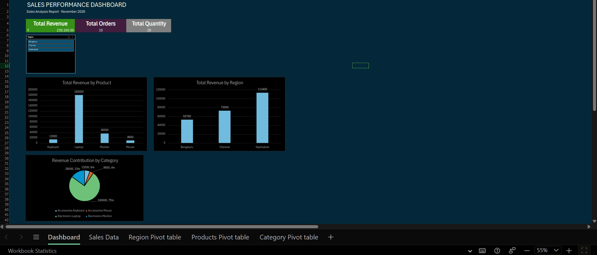

# Sales Performance Analysis using Excel

## Project Overview
This project analyzes sales data to understand revenue performance across products, regions, and categories. An interactive Excel dashboard was developed to help users explore sales performance using a Region slicer.

## Tools Used
- Microsoft Excel
- PivotTables
- PivotCharts
- Excel formulas
- Slicers
- KPI Dashboard

## Key Analysis Performed
- Calculated total revenue, total orders, total quantity, and average order value.
- Analyzed revenue by product.
- Compared sales performance across regions.
- Analyzed revenue contribution by product category.
- Created an interactive dashboard with KPI cards, charts, and a Region slicer.

## Key Findings
- Total Revenue: ₹2,39,100
- Total Orders: 10
- Total Quantity Sold: 28
- Average Order Value: ₹23,910
- Laptops contributed approximately 75.28% of total revenue.
- Hyderabad generated the highest revenue.
- Bengaluru generated the lowest revenue.
- Electronics contributed approximately 90.3% of total revenue.

## Business Recommendations
- Investigate customer demand and competitor offerings in Bengaluru to understand its lower sales performance.
- Evaluate laptop sales opportunities while considering profitability, inventory, and customer demand.
- Test product bundles, such as laptops with wireless mice, to explore cross-selling opportunities.
- Collect customer feedback and competitor pricing data for deeper analysis.

## Dashboard Features
- Interactive Region slicer.
- Dynamic KPI cards.
- Revenue by Product chart.
- Revenue by Region chart.
- Revenue by Category chart.

## Dashboard Preview

## Project Files
- `Sales_Performance_Analysis.xlsx`: Excel workbook containing the dataset, analysis, PivotTables, and interactive dashboard.

## Learning Outcomes
Through this project, I practiced data analysis using Excel, including data summarization, PivotTables, PivotCharts, KPI calculations, interactive filtering, and communicating business insights.

Note: This is a practice project based on a small sample dataset. The findings describe this dataset and should not be generalized to a larger business without further analysis.
